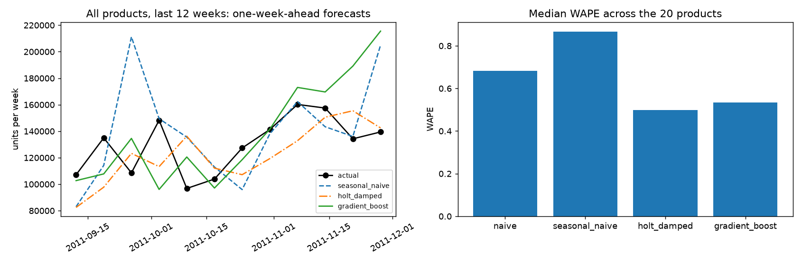

# Weekly Demand Forecasting

One-week-ahead unit forecasts for a retailer's top products, with simple baselines kept in the comparison so the fancier model has to earn its place.

**Data:** two years of invoice lines from a UK online gift retailer (UCI Online Retail II), aggregated to 104 full weeks of units for the 20 highest-revenue products that sold in at least 90 weeks, plus the total across all products. Zero-sales weeks are kept as zeros.

**Setup:** the last 12 weeks (2011-09-12 to 2011-11-28, which include the pre-Christmas ramp) are the holdout. Every forecast for a week uses only data up to the week before. The statistical models are refit at each step; the boosting model is trained once on the earlier weeks and fed actual lags. Error is reported as WAPE (sum of absolute errors over sum of actuals), which stays defined for products with zero weeks, plus MAE in units.

## Results

| Method | Products WAPE (pooled) | Products WAPE (median) | Products MAE | Total WAPE | Total MAE |
|---|---|---|---|---|---|
| Naive (last week) | 0.589 | 0.683 | 231.1 | 0.165 | 21,435 |
| Seasonal naive (same week last year) | 0.668 | 0.867 | 262.2 | 0.202 | 26,232 |
| Holt damped-trend smoothing | 0.446 | 0.499 | 175.1 | 0.167 | 21,655 |
| Gradient boosting (scale-free lags + calendar) | 0.522 | 0.534 | 204.9 | 0.196 | 25,447 |

Products won (lowest WAPE per product): Holt damped-trend smoothing 11, Gradient boosting 6, Seasonal naive 3.

- Per product, the lowest pooled WAPE is 0.446 (Holt damped-trend smoothing); the naive baseline scores 0.589.
- For the total, Naive is best (WAPE 0.165); naive scores 0.165, seasonal naive 0.202, gradient boosting 0.196.
- Seasonal naive loses to plain naive per product: last week is a better guide than the same week last year, because product-level demand here is lumpy (single large trade orders) rather than smoothly seasonal.
- Gradient boosting does beat the naive baseline on pooled product error.



Takeaway: The cheapest baseline is hard to beat on one-week-ahead product demand: Holt damped-trend smoothing has the best pooled product error and Naive the best total error. Model choice matters less than the handful of products with single-week spikes that no history-only method anticipates; those are listed with their errors in `results/errors_by_product.csv`, and that is where forecast-tuning effort (order calendars, promotion flags) would pay off.

Method notes: the boosting model uses lags 1, 2, 3, 4, 8, 52 and a 4-week rolling mean, all divided by the trailing 12-week mean, plus week of year; its target is units relative to that same mean, so one model serves products of any size and the total. Holt's smoothing uses a damped additive trend and no seasonal term, because a yearly season needs two full years of history and the training window is shorter.

## How it works

```
data/download.py     fetch the workbook, cache as parquet (not committed)
src/prepare.py       clean, pick products, build complete weekly series; results/products.csv
src/forecast.py      rolling one-step-ahead forecasts for 4 methods; results/forecasts.csv, errors_by_product.csv, metrics.json
src/report.py        render this README from results/metrics.json
notebooks/01_analysis.ipynb   the same steps with the series and errors shown
```

## Run it

```bash
python -m venv .venv && source .venv/bin/activate
pip install -r requirements.txt
./run_all.sh
```

About two minutes, plus the one-time workbook download. Every number above is read from `results/metrics.json`, which the run regenerates.

Data: [Online Retail II](https://archive.ics.uci.edu/dataset/502/online+retail+ii), UCI Machine Learning Repository (CC BY 4.0).
