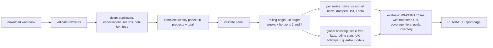
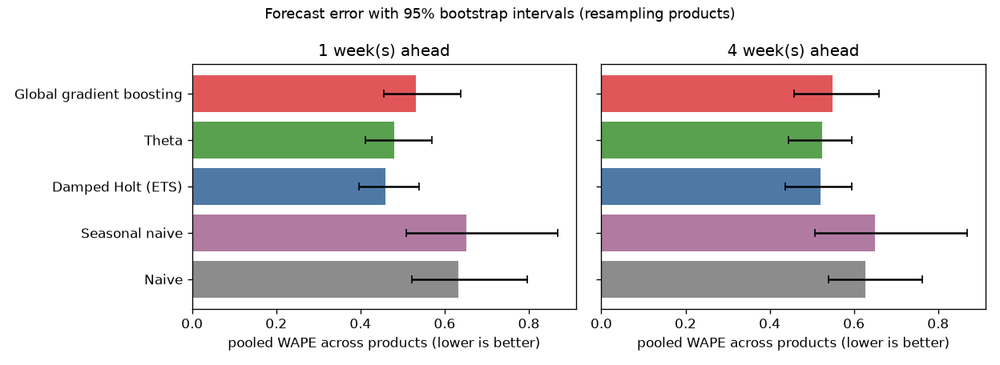
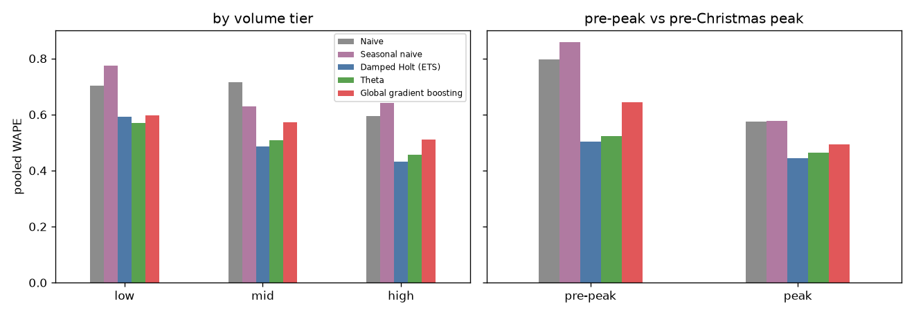

# Weekly Demand Forecasting

[](https://github.com/teozkose/demand-forecasting-weekly-sales/actions/workflows/ci.yml)

[](LICENSE)

## TL;DR

- **Question:** how many units of each top product will a wholesaler sell next week, how sure can we be, and how much stock does that imply?
- **Headline:** over a 10-week rolling-origin backtest (2011-09-26 to 2011-11-28, the run-up to Christmas), Damped Holt (ETS) forecasts the 20 top products with a pooled WAPE of **0.459** (95% CI 0.397 to 0.539), 27% below the naive last-week forecast (0.632; difference -0.259 to -0.103). For the all-products total, Global gradient boosting is best (WAPE 0.135 vs naive 0.161).
- **Decision:** forecast products with Damped Holt (ETS) and the total with Global gradient boosting, but do not size peak-season safety stock from pre-peak errors: a 95% service target fills only 87.6% of demand in the Christmas run-up.

## Problem and decision

A UK online wholesaler of gifts and homeware restocks its best sellers every week. The buyer needs a number per product for next week (and for four weeks out, for longer supplier lead times), a range around it, and a stock level that keeps shelves filled without piling up leftovers. The deciding metrics are WAPE (sum of absolute errors over sum of units, which stays defined in zero-sales weeks), bias, interval coverage, and the fill rate and leftover stock each forecast implies.

## Data

- **Source:** [UCI Online Retail II](https://archive.ics.uci.edu/dataset/502/online+retail+ii) (CC BY 4.0), a 45 MB Excel workbook with two yearly sheets. Downloaded by `make data`, cached as parquet, never committed.
- **Size and range:** 1,067,371 invoice lines, 2009-12-01 to 2011-12-09. After cleaning, 922,365 lines across 4,693 products.
- **Series:** 104 full Monday-start weeks (2009-12-07 to 2011-11-28; the partial first and last weeks are dropped). The 20 products with the most revenue among those sold in 90+ weeks carry 9.5% of revenue; weeks without sales are filled with zero (3.4% of product-weeks). A `TOTAL` series sums every product.
- **Validation** (`src/demand/validate.py`): required columns, types, nulls in key fields and the date range on the raw lines; on the panel, no duplicate (sku, week), no negative units, every series the same length on a 7-day grid, products never above the total. Any failure stops the run with the full list.
- **Cleaning** (counts from the last run):

| Step | Lines removed | Lines left |
|---|---|---|
| exact duplicate invoice lines | 34,335 | 1,033,036 |
| cancellation invoices (number starts with C) | 19,104 | 1,013,932 |
| zero or negative quantity or price | 6,019 | 1,007,913 |
| customers outside United Kingdom | 81,875 | 926,038 |
| non-product codes (postage, fees, manual, samples) | 3,673 | 922,365 |

## Approach



- **Rolling-origin backtest.** The target weeks are the last 18 weeks. For every target week t and horizon h (1 and 4 weeks), each method is fitted on weeks up to t − h only and forecasts week t (36 refits per series). The first 8 target weeks (from 2011-08-01) size safety stock; the last 10 (2011-09-26 to 2011-11-28) are the headline window. Both horizons share the same target weeks, so their errors compare directly.
- **Baselines:** naive (last observed week) and seasonal naive (same week a year earlier).
- **Statistical models, per series:** damped-trend Holt exponential smoothing (statsmodels `ExponentialSmoothing`), with an 80% interval from its residual spread, and the Theta method (statsmodels `ThetaModel`) with its analytic interval. 104 weeks is too short for a fitted yearly seasonal term, so calendar effects are left to the global model.
- **Global gradient boosting:** one scikit-learn `HistGradientBoostingRegressor` across all products, a direct model per horizon. Every input is scaled by the product's trailing 12-week mean so small and large products share one model: lags 1-4 and 8, the same week last year, 4-week mean, 8-week spread and zero share, product size, week of year, month, weeks to Christmas and a UK bank-holiday flag. Two quantile models (10th and 90th percentiles) give the 80% interval. Learning rate 0.03 and depth 3 were picked on a time-ordered block of the 8 weeks before the backtest.
- **Uncertainty:** pooled metrics get 95% CIs from 1,000 bootstrap draws over products (the unit that varies), with paired differences against naive; per-product WAPE gets CIs from resampling that product's weeks.

## Results

One week ahead, the 20 products pooled (headline window). Bias is (forecast − actual) / actual.

| Model | Product WAPE | 95% CI | vs naive (95% CI) | MAE (units) | Bias | Total WAPE |
|---|---|---|---|---|---|---|
| Naive | 0.632 | 0.523 to 0.795 | baseline | 272 | -3.8% | 0.161 |
| Seasonal naive | 0.651 | 0.508 to 0.869 | +0.019 (-0.105 to 0.201) | 280 | 13.5% | 0.167 |
| Damped Holt (ETS) | 0.459 | 0.397 to 0.539 | -0.173 (-0.259 to -0.103) | 198 | -17.8% | 0.145 |
| Theta | 0.479 | 0.411 to 0.569 | -0.152 (-0.230 to -0.100) | 206 | -14.0% | 0.147 |
| Global gradient boosting | 0.532 | 0.456 to 0.638 | -0.100 (-0.169 to -0.045) | 229 | -2.7% | 0.135 |



Four weeks ahead (same target weeks):

| Model | Product WAPE | 95% CI | vs naive (95% CI) | MAE (units) | Bias | Total WAPE |
|---|---|---|---|---|---|---|
| Naive | 0.628 | 0.540 to 0.763 | baseline | 270 | -24.4% | 0.223 |
| Seasonal naive | 0.651 | 0.508 to 0.869 | +0.023 (-0.102 to 0.208) | 280 | 13.5% | 0.167 |
| Damped Holt (ETS) | 0.521 | 0.437 to 0.594 | -0.107 (-0.220 to -0.005) | 224 | -26.2% | 0.204 |
| Theta | 0.524 | 0.446 to 0.595 | -0.104 (-0.209 to -0.017) | 225 | -24.4% | 0.199 |
| Global gradient boosting | 0.549 | 0.457 to 0.659 | -0.079 (-0.174 to 0.008) | 236 | -6.7% | 0.157 |


- Damped Holt (ETS) has the lowest product error one week ahead (0.459) and wins the most products (Damped Holt (ETS) 11, Theta 3, Seasonal naive 3, Global gradient boosting 2, Naive 1). It stays ahead four weeks out (0.521 vs naive 0.628).
- Global boosting (0.532) beats naive per product but not the per-series smoothers. It is the least biased product forecast (-3% against -18% for Damped Holt (ETS)), and it is clearly best on the total four weeks out (0.157 vs 0.204 for ETS), because the weeks-to-Christmas features see the peak coming while the smoothers only extrapolate.

**Prediction intervals (nominal 80%)**

| Weeks ahead | Model | Coverage | 95% CI | Width / actual |
|---|---|---|---|---|
| 1 | Damped Holt (ETS) | 82.5% | 76.5% to 88.0% | 1.32 |
| 1 | Theta | 81.5% | 74.5% to 87.5% | 1.32 |
| 1 | Global gradient boosting | 75.0% | 68.0% to 81.5% | 1.28 |
| 4 | Damped Holt (ETS) | 91.0% | 85.0% to 96.0% | 2.12 |
| 4 | Theta | 95.0% | 91.5% to 98.0% | 2.43 |
| 4 | Global gradient boosting | 74.5% | 66.5% to 82.0% | 1.30 |


One week ahead, the ETS interval covers 82% and the boosting quantiles 75%. Four weeks ahead the statistical intervals are too wide (Theta covers 95%) while the quantile models stay narrow and slightly under-cover (74%).

**Inventory view.** Weekly review, one-week lead time: stock each product up to forecast + z × (that model's RMSE for the product on the calibration weeks). Fill rate is units served from stock over units demanded; leftover is stock not sold that week, all products together.

| Forecast | Target | Fill rate | Weeks short | Safety stock / wk | Leftover / wk |
|---|---|---|---|---|---|
| Naive | 90% | 86.5% | 19% | 6,969 | 7,805 |
| Naive | 95% | 89.2% | 15% | 8,944 | 9,547 |
| Naive | 98% | 91.9% | 14% | 11,167 | 11,538 |
| Seasonal naive | 90% | 93.0% | 12% | 7,829 | 9,592 |
| Seasonal naive | 95% | 95.2% | 7% | 10,048 | 11,619 |
| Seasonal naive | 98% | 96.8% | 6% | 12,546 | 13,980 |
| Damped Holt (ETS) | 90% | 84.9% | 17% | 5,748 | 5,515 |
| Damped Holt (ETS) | 95% | 87.6% | 14% | 7,378 | 6,912 |
| Damped Holt (ETS) | 98% | 90.1% | 12% | 9,212 | 8,525 |
| Theta | 90% | 85.5% | 18% | 5,679 | 5,722 |
| Theta | 95% | 88.0% | 14% | 7,289 | 7,116 |
| Theta | 98% | 90.5% | 11% | 9,100 | 8,715 |
| Global gradient boosting | 90% | 87.1% | 16% | 5,628 | 6,504 |
| Global gradient boosting | 95% | 89.8% | 14% | 7,223 | 7,864 |
| Global gradient boosting | 98% | 92.5% | 12% | 9,019 | 9,434 |
| Boosting 90th percentile as stock level | 90% | 88.0% | 14% | 5,535 | 6,337 |


At a 95% target, Damped Holt (ETS) fills 87.6% of demand with 6,912 units left over per week; naive fills 89.2% with 9,547. Per unit of leftover stock, the boosting forecast buys the most service (its curve sits above the others) because it is the least biased: the most accurate forecast is not automatically the best one to stock from. No forecast reaches its target: errors measured before the peak understate the peak's volatility, and the smoothers' negative bias in a rising market adds to the shortfall. The fix is to size safety stock on last year's peak errors or to add a bias correction for the season.

## What drives it / error analysis

| Split | Segment | Products | Units | Naive | Seasonal naive | Damped Holt (ETS) | Theta | Global gradient boosting |
|---|---|---|---|---|---|---|---|---|
| tier | low | 7 | 8,038 | 0.703 | 0.775 | 0.592 | 0.569 | 0.596 |
| tier | mid | 7 | 19,641 | 0.716 | 0.628 | 0.486 | 0.507 | 0.572 |
| tier | high | 6 | 58,398 | 0.594 | 0.641 | 0.431 | 0.458 | 0.509 |
| period | pre-peak | 20 | 22,351 | 0.797 | 0.858 | 0.503 | 0.523 | 0.644 |
| period | peak | 20 | 63,726 | 0.574 | 0.578 | 0.443 | 0.464 | 0.493 |



- **Volume tier:** error falls with volume. Damped Holt (ETS) scores 0.431 on the high-volume third and 0.592 on the low-volume third, where single trade orders of a few hundred units dominate a week.
- **Christmas peak:** from 2011-10-17 on, relative error is lower (Damped Holt (ETS) 0.443 vs 0.503 before; naive 0.574 vs 0.797) because volumes are higher, but the absolute misses are larger, which is what breaks the safety stock above.
- **Per product** (Damped Holt (ETS), worst first, with week-bootstrap CIs):

| SKU | Product | WAPE | 95% CI | MAE | Bias | Naive WAPE |
|---|---|---|---|---|---|---|
| 15056N | EDWARDIAN PARASOL NATURAL | 1.27 | 0.61 to 2.83 | 51 | 108% | 1.12 |
| 48138 | DOORMAT UNION FLAG | 0.98 | 0.65 to 1.80 | 50 | 54% | 0.90 |
| 85099F | JUMBO BAG STRAWBERRY | 0.75 | 0.45 to 1.34 | 236 | 14% | 1.24 |
| 21843 | RED RETROSPOT CAKE STAND | 0.74 | 0.43 to 0.91 | 35 | -57% | 0.84 |
| 22178 | VICTORIAN GLASS HANGING T-LIGHT | 0.69 | 0.50 to 0.96 | 373 | -12% | 1.09 |
| 21621 | VINTAGE UNION JACK BUNTING | 0.69 | 0.36 to 1.15 | 17 | 69% | 0.61 |
| 21137 | BLACK RECORD COVER FRAME | 0.62 | 0.43 to 0.79 | 190 | -35% | 0.91 |
| 79321 | CHILLI LIGHTS | 0.55 | 0.38 to 0.67 | 177 | -35% | 0.82 |
| 47566 | PARTY BUNTING | 0.53 | 0.29 to 0.77 | 87 | 8% | 0.71 |
| 20685 | DOORMAT RED RETROSPOT | 0.52 | 0.32 to 0.92 | 30 | 13% | 0.67 |
| 85123A | WHITE HANGING HEART T-LIGHT HOLDER | 0.52 | 0.27 to 0.80 | 323 | -4% | 0.87 |
| 22411 | JUMBO SHOPPER VINTAGE RED PAISLEY | 0.50 | 0.28 to 0.77 | 141 | -3% | 0.59 |
| 22386 | JUMBO BAG PINK POLKADOT | 0.49 | 0.23 to 0.68 | 261 | -9% | 0.57 |
| 22112 | CHOCOLATE HOT WATER BOTTLE | 0.44 | 0.27 to 0.66 | 116 | -10% | 0.45 |
| 22197 | SMALL POPCORN HOLDER | 0.43 | 0.23 to 0.60 | 883 | -39% | 0.49 |
| 85099B | JUMBO BAG RED RETROSPOT | 0.39 | 0.19 to 0.54 | 468 | -25% | 0.63 |
| 85099C | JUMBO  BAG BAROQUE BLACK WHITE | 0.39 | 0.24 to 0.59 | 121 | -12% | 0.60 |
| 21931 | JUMBO STORAGE BAG SUKI | 0.31 | 0.16 to 0.44 | 86 | -5% | 0.55 |
| 20725 | LUNCH BAG RED RETROSPOT | 0.30 | 0.18 to 0.43 | 92 | -2% | 0.37 |
| 84879 | ASSORTED COLOUR BIRD ORNAMENT | 0.24 | 0.10 to 0.39 | 212 | -14% | 0.30 |

**Sensitivity to the backtest window** (pooled product WAPE, one week ahead): Damped Holt (ETS) ranks first in every window.

| Backtest window | Naive | Seasonal naive | Damped Holt (ETS) | Theta | Global gradient boosting |
|---|---|---|---|---|---|
| last 6 | 0.576 | 0.557 | 0.435 | 0.453 | 0.463 |
| last 10 | 0.632 | 0.651 | 0.459 | 0.479 | 0.532 |
| last 18 | 0.615 | 0.649 | 0.466 | 0.479 | 0.507 |

## Limitations and next steps

- One retailer and 104 weeks: too short for a fitted yearly seasonal term, and the backtest covers a single peak season.
- No price, promotion or stock-out data. A zero-sales week may be a stock-out, so demand is understated in exactly the weeks that matter for inventory.
- Single large trade orders cause spikes no history-only model anticipates; the order book or customer-level signals would help more than another model.
- The inventory view ignores lead-time variability, ordering costs, pack sizes and backorders.
- Next: a hierarchical reconciliation so product forecasts add up to the total, conformal calibration of the quantile intervals, and safety stock sized on the previous year's peak errors.

## Reproduce

```bash
python -m venv .venv && source .venv/bin/activate
pip install -r requirements.txt -r requirements-dev.txt
make all     # download, build the panel, backtest, render README + docs/index.html, run the notebook
make test    # 8+ tests on synthetic data, no download
```

`run_all.sh` runs the same steps. Every number above comes from `results/metrics.json` and is rendered into this README by `src/demand/report.py`; the report page is `docs/index.html`.

## Project structure

```
├── config.yaml              paths, panel, backtest, model and inventory parameters
├── Makefile, run_all.sh     make data | panel | run | report | notebook | test | all
├── data/download.py         fetches the workbook (data is never committed)
├── src/demand/
│   ├── data.py              download, cleaning with counts, weekly panel
│   ├── validate.py          raw and panel checks that fail loudly
│   ├── features.py          scale-free lags, rolling stats, UK holiday calendar
│   ├── models.py            naive, seasonal naive, damped Holt, Theta, global boosting + quantiles, tuning
│   ├── backtest.py          rolling-origin backtest over target weeks and horizons
│   ├── evaluate.py          WAPE/MAE/bias, bootstrap CIs, coverage, segments, inventory view
│   ├── figures.py, report.py
│   └── pipeline.py          python -m demand.pipeline {data,panel,run,report,all}
├── tests/                   pytest on synthetic series
├── notebooks/01_analysis.ipynb
├── results/                 metrics.json, tables (csv) and figures
└── docs/index.html          the report page
```
