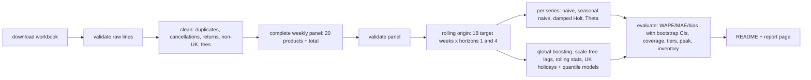
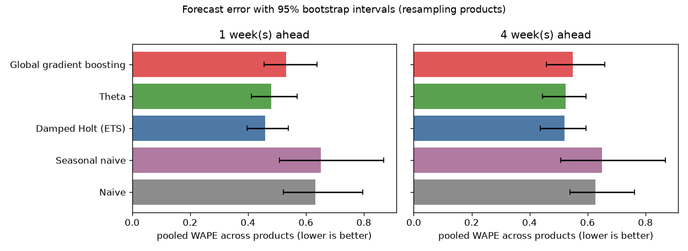
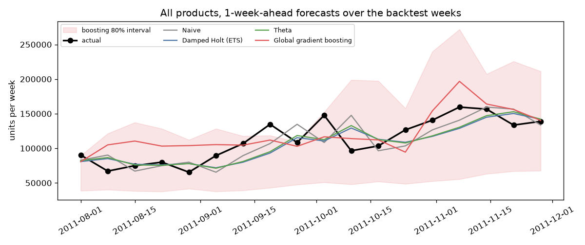
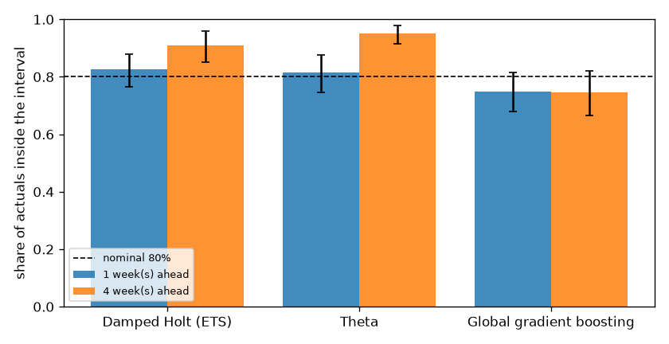
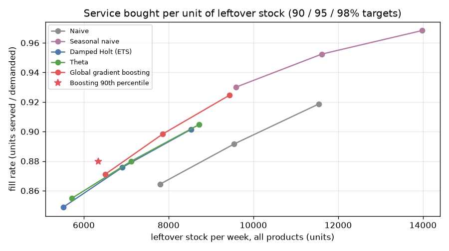
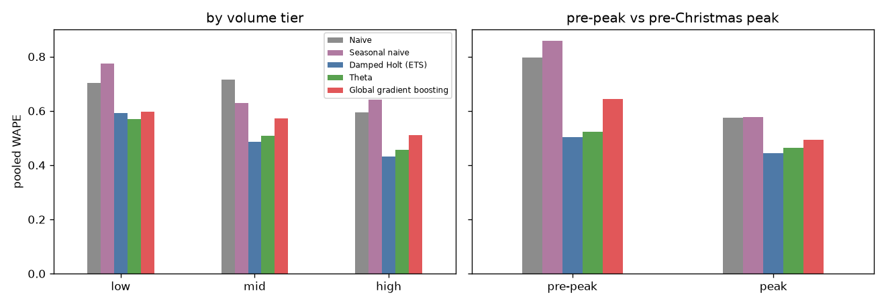

# Weekly Demand Forecasting

[](https://github.com/teozkose/demand-forecasting-weekly-sales/actions/workflows/ci.yml)

[](LICENSE)

## TL;DR

- **Question:** how many units of each top product will a wholesaler sell next week, how sure can we be, and how much stock does that imply?
- **Headline:** over a {{HEADLINE_WEEKS}}-week rolling-origin backtest ({{H_START}} to {{H_END}}, the run-up to Christmas), {{BEST}} forecasts the {{PRODUCTS}} top products with a pooled WAPE of **{{BEST_WAPE}}** (95% CI {{BEST_CI}}), {{CUT}} below the naive last-week forecast ({{NAIVE_WAPE}}; difference {{DIFF_CI}}). For the all-products total, {{BEST_TOTAL}} is best (WAPE {{BEST_TOTAL_WAPE}} vs naive {{NAIVE_TOTAL_WAPE}}).
- **Decision:** forecast products with {{BEST}} and the total with {{BEST_TOTAL}}, but do not size peak-season safety stock from pre-peak errors: a {{SL}} service target fills only {{FILL_BEST}} of demand in the Christmas run-up.

## Problem and decision

A UK online wholesaler of gifts and homeware restocks its best sellers every week. The buyer needs a number per product for next week (and for four weeks out, for longer supplier lead times), a range around it, and a stock level that keeps shelves filled without piling up leftovers. The deciding metrics are WAPE (sum of absolute errors over sum of units, which stays defined in zero-sales weeks), bias, interval coverage, and the fill rate and leftover stock each forecast implies.

## Data

- **Source:** [UCI Online Retail II](https://archive.ics.uci.edu/dataset/502/online+retail+ii) (CC BY 4.0), a 45 MB Excel workbook with two yearly sheets. Downloaded by `make data`, cached as parquet, never committed.
- **Size and range:** {{RAW_ROWS}} invoice lines, {{DATE_MIN}} to {{DATE_MAX}}. After cleaning, {{CLEAN_ROWS}} lines across {{SKUS}} products.
- **Series:** {{WEEKS}} full Monday-start weeks ({{FIRST_WEEK}} to {{LAST_WEEK}}; the partial first and last weeks are dropped). The {{PRODUCTS}} products with the most revenue among those sold in 90+ weeks carry {{REV_SHARE}} of revenue; weeks without sales are filled with zero ({{ZERO_SHARE}} of product-weeks). A `TOTAL` series sums every product.
- **Validation** (`src/demand/validate.py`): required columns, types, nulls in key fields and the date range on the raw lines; on the panel, no duplicate (sku, week), no negative units, every series the same length on a 7-day grid, products never above the total. Any failure stops the run with the full list.
- **Cleaning** (counts from the last run):

{{CLEANING_TABLE}}

## Approach



- **Rolling-origin backtest.** The target weeks are the last 18 weeks. For every target week t and horizon h (1 and 4 weeks), each method is fitted on weeks up to t − h only and forecasts week t ({{FITS}} refits per series). The first {{CALIB_WEEKS}} target weeks (from {{C_START}}) size safety stock; the last {{HEADLINE_WEEKS}} ({{H_START}} to {{H_END}}) are the headline window. Both horizons share the same target weeks, so their errors compare directly.
- **Baselines:** naive (last observed week) and seasonal naive (same week a year earlier).
- **Statistical models, per series:** damped-trend Holt exponential smoothing (statsmodels `ExponentialSmoothing`), with an 80% interval from its residual spread, and the Theta method (statsmodels `ThetaModel`) with its analytic interval. 104 weeks is too short for a fitted yearly seasonal term, so calendar effects are left to the global model.
- **Global gradient boosting:** one scikit-learn `HistGradientBoostingRegressor` across all products, a direct model per horizon. Every input is scaled by the product's trailing 12-week mean so small and large products share one model: lags 1-4 and 8, the same week last year, 4-week mean, 8-week spread and zero share, product size, week of year, month, weeks to Christmas and a UK bank-holiday flag. Two quantile models (10th and 90th percentiles) give the 80% interval. Learning rate {{LR}} and depth {{DEPTH}} were picked on a time-ordered block of the 8 weeks before the backtest.
- **Uncertainty:** pooled metrics get 95% CIs from {{N_BOOT}} bootstrap draws over products (the unit that varies), with paired differences against naive; per-product WAPE gets CIs from resampling that product's weeks.

## Results

One week ahead, the {{PRODUCTS}} products pooled (headline window). Bias is (forecast − actual) / actual.

{{TABLE_H1}}



Four weeks ahead (same target weeks):

{{TABLE_H4}}



- {{BEST}} has the lowest product error one week ahead ({{BEST_WAPE}}) and wins the most products ({{WINS}}). It stays ahead four weeks out ({{BEST_H4}} vs naive {{NAIVE_H4}}).
- Global boosting ({{GBM_WAPE}}) beats naive per product but not the per-series smoothers. It is the least biased product forecast ({{GBM_BIAS}} against {{BEST_BIAS}} for {{BEST}}), and it is clearly best on the total four weeks out ({{GBM_TOTAL_H4}} vs {{ETS_TOTAL_H4}} for ETS), because the weeks-to-Christmas features see the peak coming while the smoothers only extrapolate.

**Prediction intervals (nominal 80%)**

{{INTERVAL_TABLE}}



One week ahead, the ETS interval covers {{COV_ETS_1}} and the boosting quantiles {{COV_GBM_1}}. Four weeks ahead the statistical intervals are too wide (Theta covers {{COV_THETA_4}}) while the quantile models stay narrow and slightly under-cover ({{COV_GBM_4}}).

**Inventory view.** Weekly review, one-week lead time: stock each product up to forecast + z × (that model's RMSE for the product on the calibration weeks). Fill rate is units served from stock over units demanded; leftover is stock not sold that week, all products together.

{{INVENTORY_TABLE}}



At a {{SL}} target, {{BEST}} fills {{FILL_BEST}} of demand with {{LEFT_BEST}} units left over per week; naive fills {{FILL_NAIVE}} with {{LEFT_NAIVE}}. Per unit of leftover stock, the boosting forecast buys the most service (its curve sits above the others) because it is the least biased: the most accurate forecast is not automatically the best one to stock from. No forecast reaches its target: errors measured before the peak understate the peak's volatility, and the smoothers' negative bias in a rising market adds to the shortfall. The fix is to size safety stock on last year's peak errors or to add a bias correction for the season.

## What drives it / error analysis

{{SEGMENT_TABLE}}



- **Volume tier:** error falls with volume. {{BEST}} scores {{TIER_HIGH}} on the high-volume third and {{TIER_LOW}} on the low-volume third, where single trade orders of a few hundred units dominate a week.
- **Christmas peak:** from {{PEAK_START}} on, relative error is lower ({{BEST}} {{PEAK}} vs {{PREPEAK}} before; naive {{PEAK_NAIVE}} vs {{PREPEAK_NAIVE}}) because volumes are higher, but the absolute misses are larger, which is what breaks the safety stock above.
- **Per product** ({{BEST}}, worst first, with week-bootstrap CIs):

{{PRODUCT_TABLE}}

**Sensitivity to the backtest window** (pooled product WAPE, one week ahead): {{BEST}} {{SENS_LINE}}.

{{SENSITIVITY_TABLE}}

## Limitations and next steps

- One retailer and 104 weeks: too short for a fitted yearly seasonal term, and the backtest covers a single peak season.
- No price, promotion or stock-out data. A zero-sales week may be a stock-out, so demand is understated in exactly the weeks that matter for inventory.
- Single large trade orders cause spikes no history-only model anticipates; the order book or customer-level signals would help more than another model.
- The inventory view ignores lead-time variability, ordering costs, pack sizes and backorders.
- Next: a hierarchical reconciliation so product forecasts add up to the total, conformal calibration of the quantile intervals, and safety stock sized on the previous year's peak errors.

## Reproduce

```bash
python -m venv .venv && source .venv/bin/activate
pip install -r requirements.txt -r requirements-dev.txt
make all     # download, build the panel, backtest, render README + docs/index.html, run the notebook
make test    # 8+ tests on synthetic data, no download
```

`run_all.sh` runs the same steps. Every number above comes from `results/metrics.json` and is rendered into this README by `src/demand/report.py`; the report page is `docs/index.html`.

## Project structure

```
├── config.yaml              paths, panel, backtest, model and inventory parameters
├── Makefile, run_all.sh     make data | panel | run | report | notebook | test | all
├── data/download.py         fetches the workbook (data is never committed)
├── src/demand/
│   ├── data.py              download, cleaning with counts, weekly panel
│   ├── validate.py          raw and panel checks that fail loudly
│   ├── features.py          scale-free lags, rolling stats, UK holiday calendar
│   ├── models.py            naive, seasonal naive, damped Holt, Theta, global boosting + quantiles, tuning
│   ├── backtest.py          rolling-origin backtest over target weeks and horizons
│   ├── evaluate.py          WAPE/MAE/bias, bootstrap CIs, coverage, segments, inventory view
│   ├── figures.py, report.py
│   └── pipeline.py          python -m demand.pipeline {data,panel,run,report,all}
├── tests/                   pytest on synthetic series
├── notebooks/01_analysis.ipynb
├── results/                 metrics.json, tables (csv) and figures
└── docs/index.html          the report page
```
